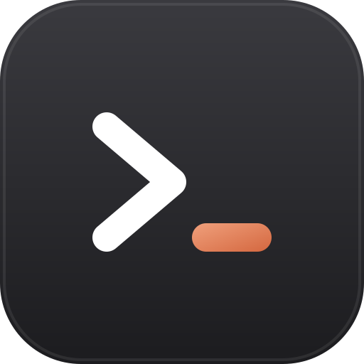
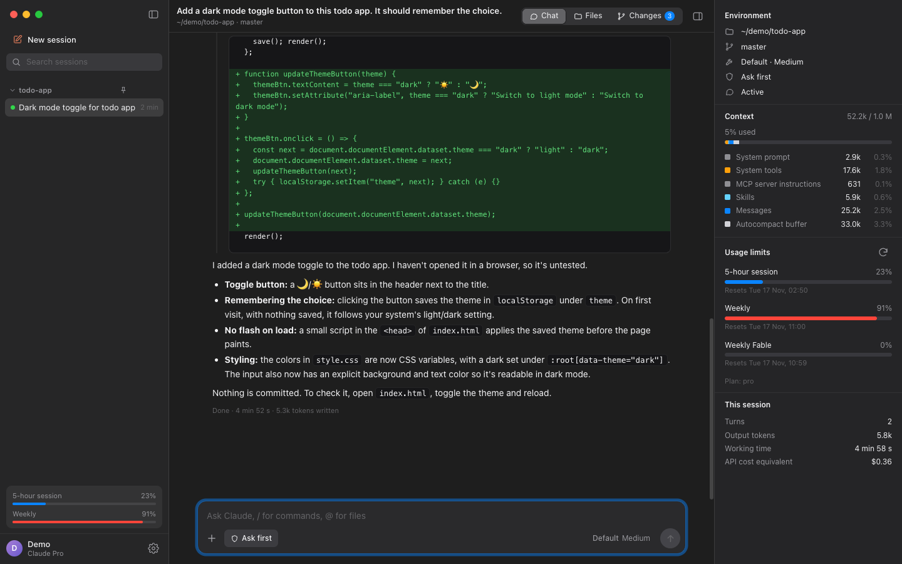

<div align="center">



# Claude Code Hub

**Tampilan web ala macOS untuk Claude Code, jalan di server sendiri, bisa dibuka dari browser mana saja, termasuk HP.**

Mulai tugas dari laptop, setujui perintah dari HP saat di jalan, cek diff-nya begitu sampai rumah.<br>
Kode tetap di server kamu. Tidak perlu terminal.

[English](README.md) · [Fitur](#fitur) · [Mulai cepat](#mulai-cepat) · [Jalan terus](#jalan-terus-24-jam) · [Akses dari luar](#akses-dari-mana-saja) · [Keamanan](#keamanan)



</div>

---

## Kenapa?

Claude Code sangat bagus di terminal, tapi terminal susah dipakai dari HP dan sesi SSH gampang putus. Claude Code Hub menjalankan **Claude Code asli** (lewat [Agent SDK](https://docs.anthropic.com/en/docs/claude-code/sdk) resmi dari Anthropic) di balik tampilan yang bersih dan terasa seperti aplikasi Mac:

- **Jalan di server kamu**: server rumah, VPS, Raspberry Pi, atau PC. Claude langsung mengerjakan file yang ada di sana.
- **Nyaman di HP**: tata letak khusus HP, bukan terminal yang dipaksa kecil. Bisa ditambahkan ke layar utama seperti aplikasi.
- **Sesi tetap jalan** walau tab ditutup atau sinyal hilang. Buka lagi dari perangkat mana pun, langsung lanjut.
- **Kamu tetap pegang kendali**: tiap perintah dan edit file bisa muncul sebagai kartu *Izinkan / Selalu izinkan / Tolak*, lengkap dengan pratinjau diff.

## Fitur

- **Chat langsung**: jawaban mengalir, bagian "berpikir" bisa dibuka, langkah-langkah diringkas jadi *"3 perintah, 2 edit ›"* dan bisa dibuka untuk melihat perintah, keluaran, dan diff.
- **Kartu izin**: Izinkan, Selalu izinkan, atau Tolak dengan alasan. Edit file menampilkan diff merah/hijau sebelum disetujui.
- **Mode Rencana**: Claude menyusun rencana. Kamu bisa *Setujui & jalankan*, *Setujui, tanya tiap edit*, atau *Tetap rencanakan* dengan masukan.
- **Pertanyaan**: kalau Claude bertanya, muncul pilihan yang tinggal diketuk, plus kolom jawaban lain.
- **Semua model**: pemilih model sama seperti aplikasi resmi. Ada Default, Opus, Sonnet, Fable, Haiku, **Model lain ›** (versi lama), dan **Effort ›** dari Rendah sampai Maksimal.
- **Mode izin**: Tanya dulu, Terima edit, Rencana, Otomatis, Bypass (dengan peringatan). `Shift+Tab` untuk berganti mode.
- **Batas pemakaian**: kuota 5 jam dan mingguan beserta jam reset, isi konteks, dan total per sesi.
- **Pemilih folder ala Finder** untuk semua folder di server. Folder favorit bisa disematkan.
- **Sesi**: semua percakapan tersimpan (riwayat Claude Code biasa, jadi CLI juga melihatnya). Bisa dicari, diganti nama, dihapus, dan dilanjutkan.
- **Tab Perubahan**: status git, diff tiap file, commit terakhir, dan kotak commit.
- **Tab File**: lihat isi kode, Markdown, dan gambar, lalu **@sebut** file di chat.
- **Kembalikan file** ke keadaan sebelum pesan tertentu.
- **Gambar**: tempel, seret, atau lampirkan screenshot.
- **Perintah `/` dan file `@`** dengan pelengkapan otomatis.
- **Notifikasi** Telegram, [ntfy](https://ntfy.sh), atau perintah sendiri saat Claude butuh izin atau selesai.
- **Tab Terminal** (opsional), misalnya [ttyd](https://github.com/tsl0922/ttyd).
- **Terang & gelap** mengikuti sistem.
- **Bahasa Inggris & Indonesia**, otomatis dari bahasa browser. Bisa diganti di Pengaturan.
- **Login bawaan** dengan kata sandi, atau pakai login reverse proxy sendiri.

## Mulai cepat

**Butuh:** Linux atau macOS dengan **Node.js 20+** dan **[Claude Code](https://docs.anthropic.com/en/docs/claude-code/setup)** yang sudah login (jalankan `claude` sekali lalu login), atau `ANTHROPIC_API_KEY`.

```bash
git clone https://github.com/haidarobot/claude-code-hub.git
cd claude-code-hub
npm install
npm start
```

Buka **http://127.0.0.1:3010** di komputer yang sama.

Supaya bisa dibuka dari **perangkat lain** (misalnya HP), pasang kata sandi:

```bash
cp .env.example .env
# ubah .env:
#   HOST=0.0.0.0
#   AUTH_PASSWORD=kata-sandi-panjang-acak
npm start
```

Semua pengaturan lain (folder tambahan, terminal, notifikasi) ada di [`.env.example`](.env.example) dan di [tabel konfigurasi](README.md#configuration).

## Jalan terus 24 jam

Pakai systemd, contohnya di [`examples/claude-code-hub.service`](examples/claude-code-hub.service). Layanan harus berjalan sebagai **user yang sama** dengan yang login ke Claude Code.

```bash
sudo cp examples/claude-code-hub.service /etc/systemd/system/
sudo systemctl daemon-reload
sudo systemctl enable --now claude-code-hub
```

## Akses dari mana saja

Cara paling mudah adalah **Tailscale**, karena tidak perlu membuka port:

```bash
sudo tailscale serve --bg --https 443 http://127.0.0.1:3010
```

Lalu buka `https://nama-mesin.nama-tailnet.ts.net` di HP. Cara lain: Caddy dengan HTTPS ([`examples/Caddyfile`](examples/Caddyfile)) atau Cloudflare Tunnel + Access.

## Keamanan

Claude Code bisa menjalankan perintah di mesinmu, jadi perlakukan aplikasi ini seperti login SSH.

- Bawaannya hanya mendengarkan **127.0.0.1**, dan **menolak jalan** di alamat lain tanpa `AUTH_PASSWORD` atau `AUTH_MODE=proxy`.
- Ada batas percobaan login, cookie aman, pemeriksaan asal permintaan, dan Content-Security-Policy ketat.
- Gunakan HTTPS untuk akses di luar jaringan rumah.
- Pilih mode **Tanya dulu** atau **Otomatis**. Mode **Bypass** hanya untuk sandbox.

## Lisensi

[MIT](LICENSE) © haidarobot. Kalau proyek ini membantu, kasih supaya orang lain juga menemukannya.

<sub>Claude dan Claude Code adalah merek dagang Anthropic, PBC. Proyek ini tidak berafiliasi dengan Anthropic.</sub>
