<div align="center">

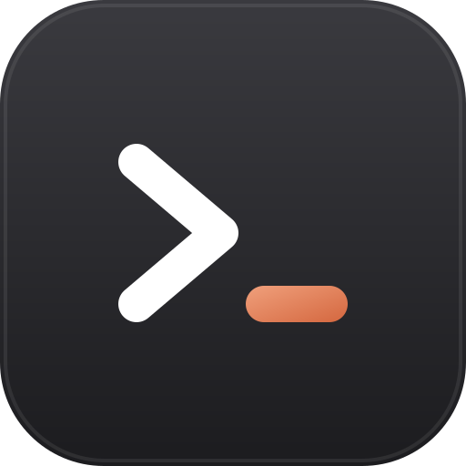

# Claude Code Hub

**A beautiful, macOS‑style web UI for Claude Code — running on your own server, usable from any browser, including your phone.**

Start a task from your laptop, approve a command from your phone on the bus, review the diff when you get home.<br>
Your code never leaves your server. No terminal required.

[Features](#features) · [Screenshots](#screenshots) · [Quick start](#quick-start) · [Run it 24/7](#run-it-247) · [Remote access](#use-it-from-anywhere) · [Security](#security) · [FAQ](#faq) · [Bahasa Indonesia](README.id.md)


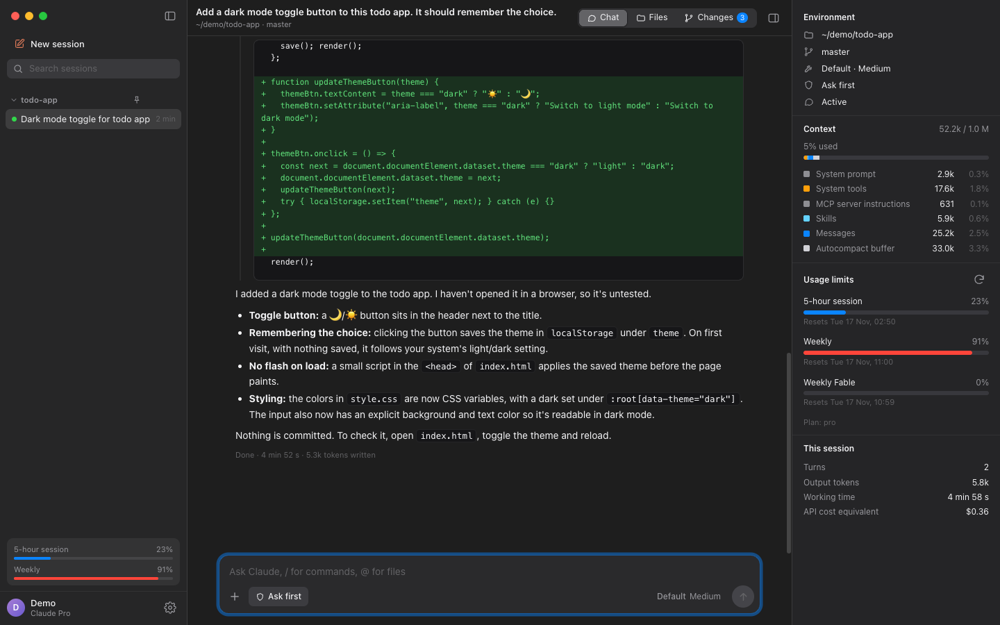

</div>

---

## Why?

[Claude Code](https://docs.anthropic.com/en/docs/claude-code) is amazing in a terminal, but a terminal is hard to use from a phone, and keeping an SSH session alive is a pain. Claude Code Hub puts the **real Claude Code** (through Anthropic's official [Agent SDK](https://docs.anthropic.com/en/docs/claude-code/sdk)) behind a clean, native‑feeling interface that you open in a browser:

- 🖥️ It **runs on your server** — a home server, a VPS, a Raspberry Pi, your desktop. Claude works on the files that are already there.
- 📱 It **works great on a phone** — a proper mobile layout, not a squeezed terminal. Add it to your home screen and it feels like an app.
- 🔁 **Sessions keep running** when you close the tab or lose signal. Come back from any device and pick up exactly where you left off.
- ✋ **You stay in control** — every command and file edit can show up as a card with *Allow / Always allow / Deny*, with a diff preview.

## Features

| | |
|---|---|
| 💬 **Live chat** | Streaming answers, collapsible "thinking", tool steps grouped like *"3 commands, 2 edits ›"* that you can expand to see every command, output and diff. |
| ✋ **Permission cards** | Allow, always allow, or deny each action — with an optional reason that is sent back to Claude. Edits show a red/green diff before you approve. |
| 🗺️ **Plan mode** | Claude researches and writes a plan; you review it as a nicely formatted card and choose *Approve & run*, *Approve, ask for each edit*, or *Keep planning* with feedback. |
| ❓ **Questions** | When Claude asks you something (multiple choice), you get tappable options plus an "other answer" box. |
| 🧠 **All the models** | The same model picker as the official app: Default, Opus, Sonnet, Fable, Haiku, **More models ›** (older versions) and **Effort ›** from Low to Max. Switch mid‑conversation. |
| 🛡️ **Permission modes** | Ask first · Accept edits · Plan · Auto (classifier) · Bypass (with a warning). `Shift+Tab` cycles like the CLI. |
| 📊 **Usage limits** | Your plan's 5‑hour and weekly limits with reset times, right in the sidebar — no more guessing. Plus a context‑window breakdown (system prompt, tools, MCP, messages…) and per‑session totals. |
| 📁 **Finder‑style folder picker** | Pick any folder on the server as a project. Pin your favourites. Add your own locations (disks, web roots…). |
| 🗂️ **Sessions** | Every conversation is saved (it's the normal Claude Code history, so the CLI sees them too). Search, rename, delete, resume. Status dots show which sessions are working or waiting for you. |
| 🌿 **Changes tab** | `git status` + a diff of every changed file, recent commits, and a commit box. |
| 📄 **Files tab** | Browse the project, preview code (with line numbers), Markdown and images, and **@mention** a file in chat with one tap. |
| ⏪ **Restore files** | Roll the project's files back to the moment before any of your messages (uses Claude Code's file checkpoints). |
| 🖼️ **Images** | Paste, drop or attach screenshots. Large images are resized in the browser to save tokens. |
| ⌨️ **Slash commands & @files** | `/` autocompletes every command and skill Claude Code knows; `@` searches files in the project. |
| 🔔 **Notifications** | Get a Telegram, [ntfy](https://ntfy.sh) or custom notification when Claude needs permission or finishes a long task while you're away. Browser notifications too (over HTTPS). |
| 🖥️ **Terminal tab** *(optional)* | Embed any web terminal (e.g. [ttyd](https://github.com/tsl0922/ttyd)) as a tab. |
| 🌗 **Light & dark** | Follows your system. SF Pro typography, vibrancy sidebar, segmented controls — it looks and feels like a Mac app. |
| 🌐 **English & Indonesian** | Picks your browser language; switch any time in ⚙️ Settings. Translations are one small file — PRs for more languages welcome! |
| 🔐 **Built‑in login** | Password login with a signed, HttpOnly cookie — or plug it behind your own reverse‑proxy auth. Refuses to start exposed without auth. |
| 🪶 **Tiny** | ~2,500 lines of plain JavaScript. No framework, no build step, 4 dependencies. |

## Screenshots

<table>
<tr>
<td width="50%">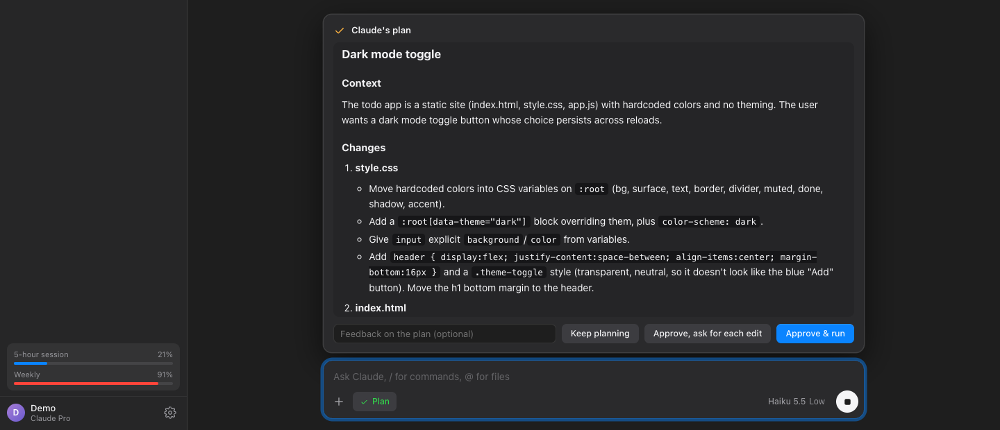<br><sub><b>Plan mode</b> — review Claude's plan, then approve & run.</sub></td>
<td width="50%">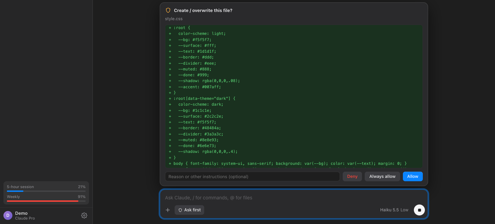<br><sub><b>Permissions</b> — see the diff before a file is written.</sub></td>
</tr>
<tr>
<td>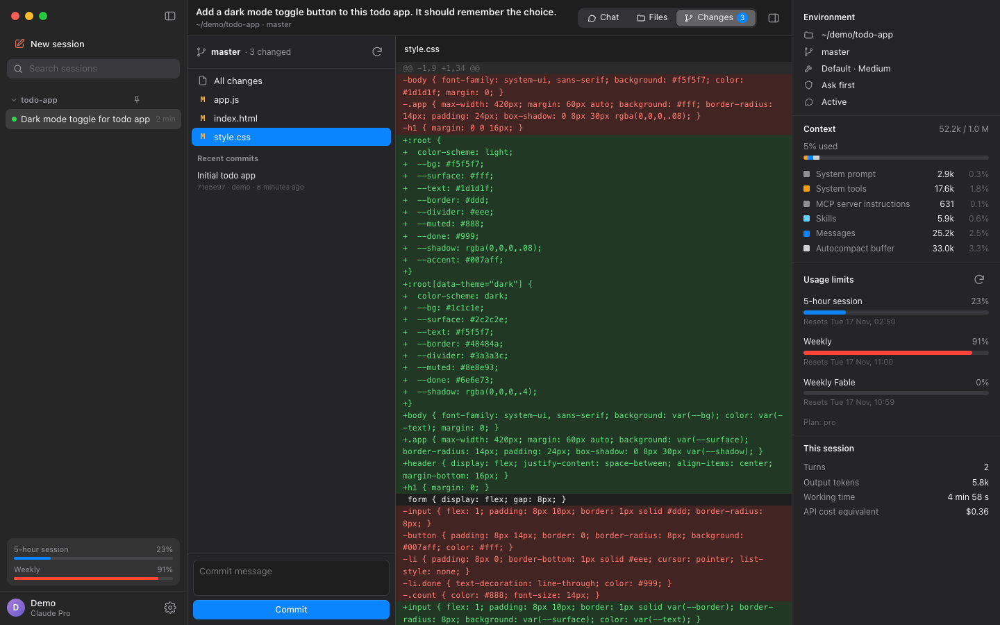<br><sub><b>Changes</b> — git status, diffs and commits.</sub></td>
<td>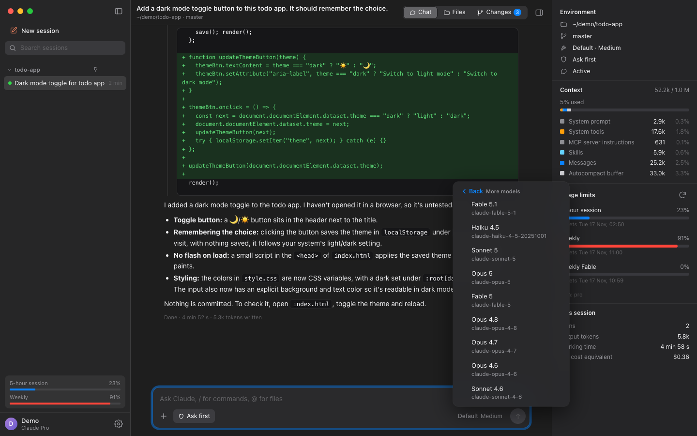<br><sub><b>Models</b> — every model and effort level, like the official app.</sub></td>
</tr>
<tr>
<td>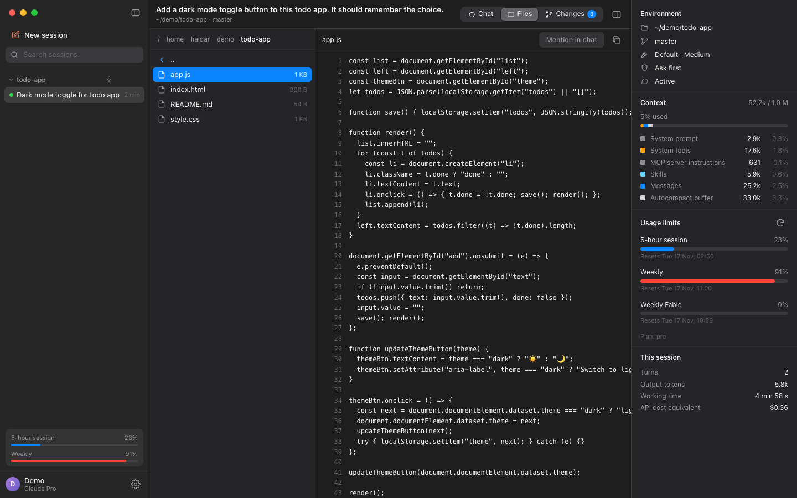<br><sub><b>Files</b> — browse and preview, then @mention in chat.</sub></td>
<td>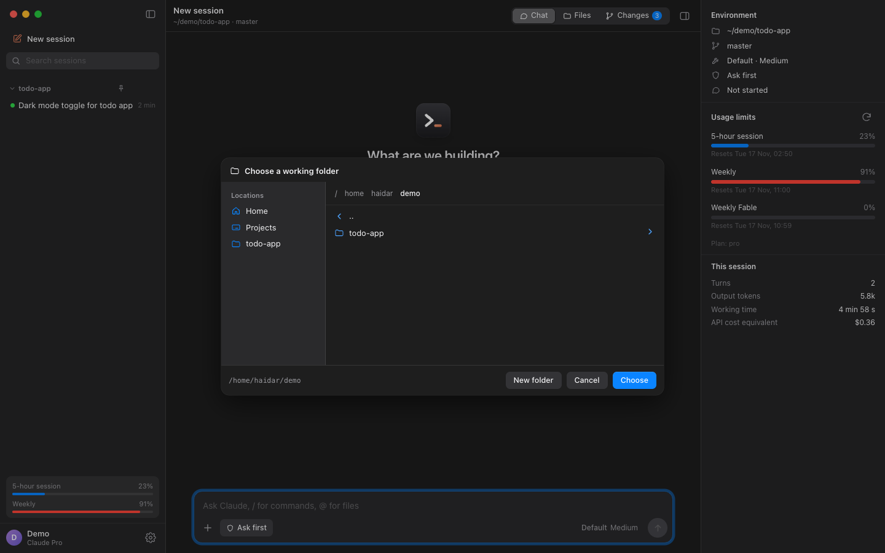<br><sub><b>Folder picker</b> — any folder on your server.</sub></td>
</tr>
<tr>
<td colspan="2">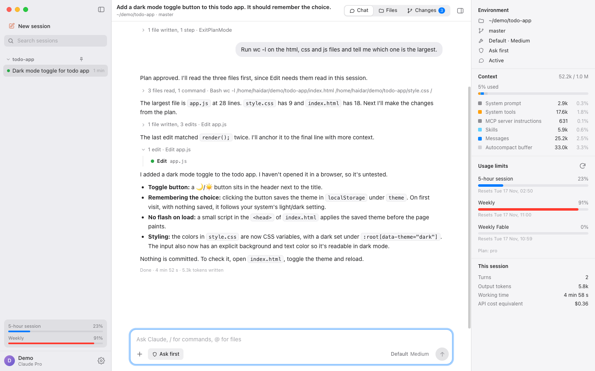<br><sub><b>Light mode</b> with the session inspector: context window, usage limits and session totals.</sub></td>
</tr>
</table>

### On your phone

<table>
<tr>
<td width="33%">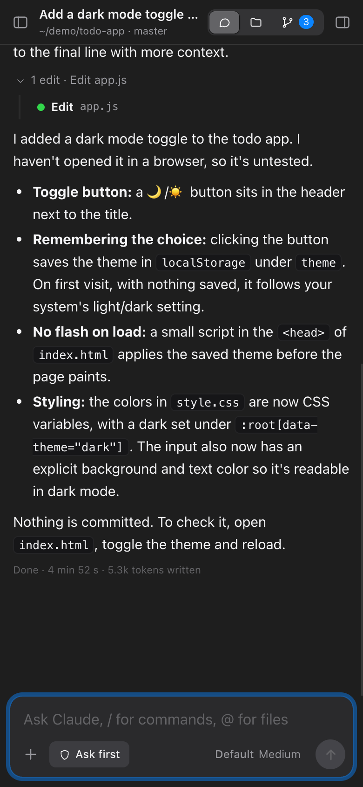</td>
<td width="33%">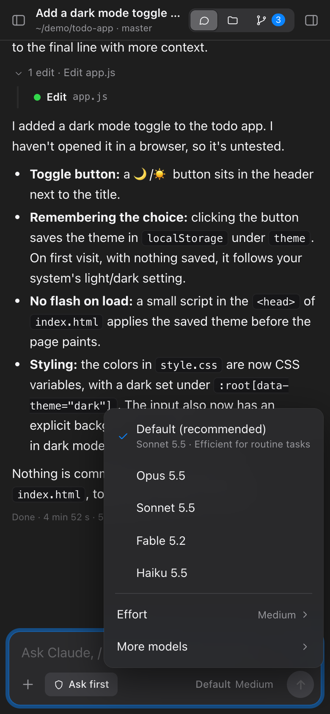</td>
<td width="33%">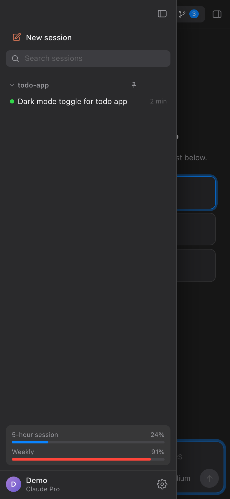</td>
</tr>
</table>

## Quick start

**You need:** a Linux or macOS machine with **Node.js 20+** and **[Claude Code](https://docs.anthropic.com/en/docs/claude-code/setup)** signed in (run `claude` once and log in), or an `ANTHROPIC_API_KEY` in the environment.

```bash
git clone https://github.com/haidarobot/claude-code-hub.git
cd claude-code-hub
npm install
npm start
```

Open **http://127.0.0.1:3010** on the same machine. That's it.

To open it from **other devices** (your phone!), give it a password and listen on the network:

```bash
cp .env.example .env
# edit .env:
#   HOST=0.0.0.0
#   AUTH_PASSWORD=a-long-random-password
npm start
```

> [!TIP]
> Generate a strong password with `openssl rand -base64 24`. Even better: keep `HOST=127.0.0.1` and reach it through Tailscale or a reverse proxy with HTTPS — see [Use it from anywhere](#use-it-from-anywhere).

## Configuration

Everything is an environment variable (or a line in `.env`). All of them are optional.

| Variable | Default | What it does |
|---|---|---|
| `HOST` | `127.0.0.1` | Address to listen on. Anything other than localhost **requires** a login (`AUTH_PASSWORD` or `AUTH_MODE=proxy`). |
| `PORT` | `3010` | Port. |
| `AUTH_PASSWORD` | – | Enables the built‑in login page. |
| `AUTH_MODE` | – | `proxy` = a reverse proxy in front already authenticates users (Authelia, Caddy `forward_auth`, Cloudflare Access, oauth2‑proxy…). |
| `PLACES` | – | Extra locations in the folder picker: `Projects=/srv/projects,Web=/var/www`. Home is always there. |
| `TERMINAL_URL` | – | Shows a Terminal tab embedding this URL. `{proto}` and `{host}` are filled from the browser, e.g. `{proto}//{host}:7681/`. |
| `DISPLAY_NAME` | Linux user | Name in the sidebar. |
| `CLAUDE_BIN` | `~/.local/bin/claude` | Claude Code binary. If missing, the CLI bundled with the Agent SDK is used. |
| `IDLE_CLOSE_MIN` | `30` | Stop an idle session's Claude process after N minutes. History is kept; your next message resumes it. |
| `STATE_DIR` | `~/.claude-hub` | Pins, preferences and the cookie secret. |
| `TELEGRAM_BOT_TOKEN` + `TELEGRAM_CHAT_ID` | – | Telegram notifications. |
| `NTFY_URL` | – | ntfy notifications, e.g. `https://ntfy.sh/my-secret-topic`. |
| `NOTIFY_COMMAND` | – | Any program; the message is passed as its last argument (no shell). |

Notifications are only sent when **no one has the page open**, so you won't get pinged while you're watching.

## Run it 24/7

Create a systemd service (replace `YOUR_USER` and the path) — see [`examples/claude-code-hub.service`](examples/claude-code-hub.service):

```ini
[Unit]
Description=Claude Code Hub
After=network-online.target

[Service]
User=YOUR_USER
WorkingDirectory=/opt/claude-code-hub
ExecStart=/usr/bin/node src/server.js
Restart=on-failure
KillMode=mixed

[Install]
WantedBy=multi-user.target
```

```bash
sudo cp examples/claude-code-hub.service /etc/systemd/system/
sudo systemctl daemon-reload
sudo systemctl enable --now claude-code-hub
```

The service must run as **the same user that is logged in to Claude Code**, so it can use that login and history.

## Use it from anywhere

Pick one:

**Tailscale (easiest, no open ports).** Install [Tailscale](https://tailscale.com) on the server and your phone, keep `HOST=127.0.0.1`, then:

```bash
sudo tailscale serve --bg --https 443 http://127.0.0.1:3010
```

Open `https://your-machine.your-tailnet.ts.net` on your phone. Only devices in your tailnet can reach it. Set `AUTH_PASSWORD` too if other people share your tailnet.

**Caddy with HTTPS** — see [`examples/Caddyfile`](examples/Caddyfile):

```caddy
code.example.com {
	reverse_proxy 127.0.0.1:3010
}
```

with `AUTH_PASSWORD` set, or with your own `forward_auth` and `AUTH_MODE=proxy`.

**Cloudflare Tunnel / Access** also works great: point the tunnel at `http://127.0.0.1:3010` and protect it with an Access policy (`AUTH_MODE=proxy`).

## How it works

```
 Browser (desktop / phone)
        │  HTTPS + WebSocket
        ▼
 Claude Code Hub (Node.js)  ── src/server.js   HTTP API, WebSocket, login
        │                     src/live.js     one Claude Code process per active session
        │                     src/files.js    folders, file preview, git
        ▼
 Claude Agent SDK  →  Claude Code CLI  →  your files, your tools, your MCP servers
```

- Each active conversation is a real Claude Code process started through the official **Claude Agent SDK**, with your normal settings, `CLAUDE.md`, skills, MCP servers and permission rules.
- Permission prompts go through the SDK's `canUseTool` callback and become cards in the browser. The process waits until you answer, from any device.
- History is Claude Code's own session files (`~/.claude/projects`), so sessions started in the terminal show up in the hub and the other way round.
- Usage limits, context and the model list come from the SDK's control API — reading them **costs no tokens**.
- The frontend is plain HTML/CSS/JS (no build). Markdown is rendered with `marked` and sanitized with `DOMPurify`.

## Security

Claude Code can run commands on your machine, so treat this like an SSH login.

- It listens on **127.0.0.1** by default and **refuses to start** on another address without `AUTH_PASSWORD` or `AUTH_MODE=proxy`.
- Built‑in login: constant‑time password check, rate limiting (10 tries / 10 min per IP), signed HttpOnly `SameSite=Lax` cookie (`Secure` over HTTPS). Changing the password signs everyone out.
- WebSocket and POST requests must come from the same origin (blocks cross‑site attacks), and a strict Content‑Security‑Policy is set.
- Use HTTPS (Tailscale serve, Caddy, Cloudflare) for anything beyond your LAN.
- Prefer **Ask first** or **Auto** mode. **Bypass** runs everything without asking — only use it in a sandbox.
- Run the service as a normal user, not root.

Found a problem? Please see [SECURITY.md](SECURITY.md).

## FAQ

**Does it use my Claude subscription or an API key?**
Whatever Claude Code on that machine uses. If you're logged in with `claude` (Pro/Max), the hub uses that; if `ANTHROPIC_API_KEY` is set, it uses the key. Please follow Anthropic's terms for how your account may be used.

**Is this the official Claude Code app?**
No. It's an independent, open‑source project that drives the official Claude Code through Anthropic's public Agent SDK. Not affiliated with or endorsed by Anthropic.

**Do sessions continue if I close the browser?**
Yes. Claude keeps working on the server. If it needs your permission it waits (and can notify you). Idle processes are stopped after `IDLE_CLOSE_MIN` minutes, but the conversation is saved and resumes when you send the next message.

**Can several people use it?**
It's designed as a personal tool: everyone who logs in acts as the same Linux user. For a team, run one instance per user.

**Windows?**
Not tested. Linux and macOS are supported. WSL should work.

**Can I add my language?**
Yes! Add your strings to [`public/i18n.js`](public/i18n.js) and open a pull request.

## Contributing

Issues and pull requests are welcome — see [CONTRIBUTING.md](CONTRIBUTING.md). If this project helps you, a ⭐ helps other people find it.

## License

[MIT](LICENSE) © haidarobot

<sub>Claude and Claude Code are trademarks of Anthropic, PBC. This project is not affiliated with Anthropic.</sub>
